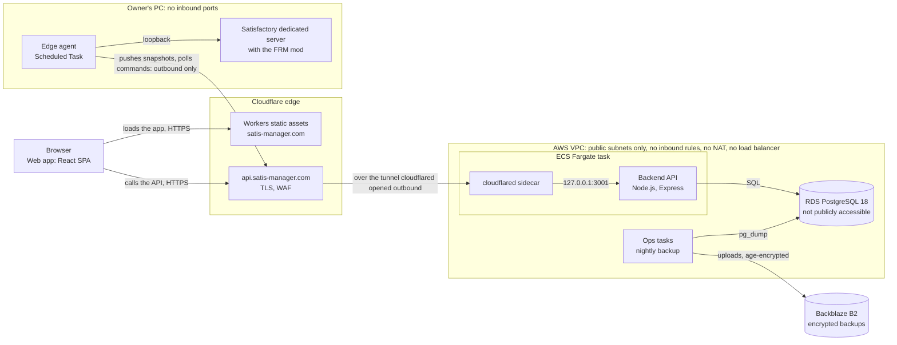

# satisfactory-dash

A web dashboard + backend for a live Satisfactory dedicated server: production rate,
overflow, power outages, and more. Two-process monolith for now (Vite/React frontend +
Express/TypeScript backend), designed to scale to multiple servers on AWS later. See
`CLAUDE.md` for the working rules Claude Code follows in this project, and `LEGAL.md`
for the (unresolved) licensing/monetization question.

## Getting started

```bash
npm install   # first time only: installs all workspaces
npm run dev   # starts both dev servers
```

- Frontend: http://localhost:5173
- Backend: http://localhost:3001 (try http://localhost:3001/api/health)

## Project layout

npm workspaces monorepo:

- `frontend/` — Vite + React + TypeScript SPA
- `backend/` — Express + TypeScript API server; this is where the Satisfactory
  dedicated-server / FicsitRemoteMonitoring adapter will live
  (`backend/src/modules/gameserver/`)
- `packages/shared/` — TypeScript types shared between frontend and backend (the API
  contract)
- `docs-vault/raw-sources/` — immutable copies of Satisfactory API docs and sample
  responses (see the README inside for what to add)
- `docs-vault/wiki/` — living notes Claude maintains from raw-sources, including
  `data-gap-analysis.md`

## Commands

- `npm run dev` — both dev servers together
- `npm run lint` / `npm run typecheck` / `npm run test` / `npm run build` — across all
  workspaces (also runs in CI on every push/PR — see `.github/workflows/ci.yml`)

## Architecture

What runs where today. Every box and arrow comes from the "Today" deployment environment of the
C4 model, [`docs-vault/workspace.dsl`](docs-vault/workspace.dsl) (ADR-0024), which has the full
picture: containers, backend modules, the planned target, and the AWS secrets and ops tasks left out
here. The Architecture workflow validates it and publishes its diagrams on every PR.



Every connection into the PC and into AWS starts on the inside: cloudflared and the agent dial out,
and nothing reaches in. See [Deployment](#deployment) for the runbooks behind each part.

## Why these choices

Each line is the project-specific reason from the decision record it links.

- **One ECS Fargate task, no load balancer, no NAT gateway**: the account runs on the AWS Free
  plan's credits, so the backend and its cloudflared sidecar share one 0.5 vCPU task (about $33 a
  month), and nothing on the app path is AWS-only, so the exit to another host stays boring
  ([ADR-0034](docs-vault/wiki/decisions/0034-backend-on-aws.md)).
- **A Cloudflare Tunnel instead of open ports or a public load balancer**: cloudflared connects out,
  so the game PC never needed port forwarding and AWS has no inbound rule; moving hosts is a tunnel
  route switch, and the agent, frontend and DNS name don't change
  ([ADR-0013](docs-vault/wiki/decisions/0013-deployment-topology.md),
  [ADR-0034](docs-vault/wiki/decisions/0034-backend-on-aws.md)).
- **The agent pushes out; the backend never reaches into the player's network**: the game's API
  token is admin-level and FRM is plain HTTP, so neither may leave the game PC, and the agent keeps
  the tokens there ([ADR-0031](docs-vault/wiki/decisions/0031-edge-agent.md)).
- **One PostgreSQL for accounts, servers and history**: at this scale it's one store to operate, with
  ACID where it matters, and plain PostgreSQL (no RDS-only extensions) moves with `pg_dump`
  ([ADR-0020](docs-vault/wiki/decisions/0020-multi-user-data-model.md),
  [ADR-0034](docs-vault/wiki/decisions/0034-backend-on-aws.md)).
- **Backups on Backblaze B2, not AWS**: the AWS account closes when the credits run out, so backups
  must not depend on it; B2 needs no card, and Object Lock stops a leaked upload key from deleting
  recent backups ([ADR-0035](docs-vault/wiki/decisions/0035-backups-off-aws.md)).
- **The live map on Leaflet's canvas renderer**: buildings drawn as canvas markers stay smooth into
  the thousands, where MapLibre GL is built for geographic maps and needs worker/blob CSP allowances
  ([ADR-0023](docs-vault/wiki/decisions/0023-live-map.md)).
- **Fixed-bucket metrics in Postgres, not OpenTelemetry yet**: one process has no traces to join,
  and a collector would add a moving part and pull toward X-Ray and CloudWatch, which ADR-0034
  forbids; OTel-convention names keep a later exporter a one-to-one mapping
  ([ADR-0037 §4](docs-vault/wiki/decisions/0037-performance-metrics-and-load-testing.md)).
- **AGPL-3.0-only**: under MIT anyone could run a closed, competing hosted service; AGPL §13 makes a
  modified network service offer its source, and the copyright holder can still dual-license
  ([ADR-0018](docs-vault/wiki/decisions/0018-license-agpl.md)).

## Deployment

The same system as the [Architecture](#architecture) diagram, part by part:

- **Frontend** → Cloudflare Workers static assets at `https://satis-manager.com`
  (ADR-0013 and its amendment; configured by `frontend/wrangler.jsonc`). Cloudflare's Git
  build deploys it on every merge to `main`.
- **Backend** → runs on AWS: one ECS Fargate service (the backend and cloudflared in one task)
  with RDS PostgreSQL private to the VPC, reached through the Cloudflare Tunnel at
  `api.satis-manager.com`. See [`docs-vault/wiki/runbooks/aws.md`](docs-vault/wiki/runbooks/aws.md)
  and the cutover issue #217.
- **Game-server PC** → runs only the edge agent (`agent/`), which reads the game server over
  loopback and posts its snapshots to `https://api.satis-manager.com`; see
  [`docs-vault/wiki/runbooks/agent-app.md`](docs-vault/wiki/runbooks/agent-app.md).

## License

GNU Affero General Public License v3.0 only (`AGPL-3.0-only`); see [`LICENSE`](LICENSE) and
[`LEGAL.md`](LEGAL.md). Versions up to the last MIT commit remain available under MIT.
