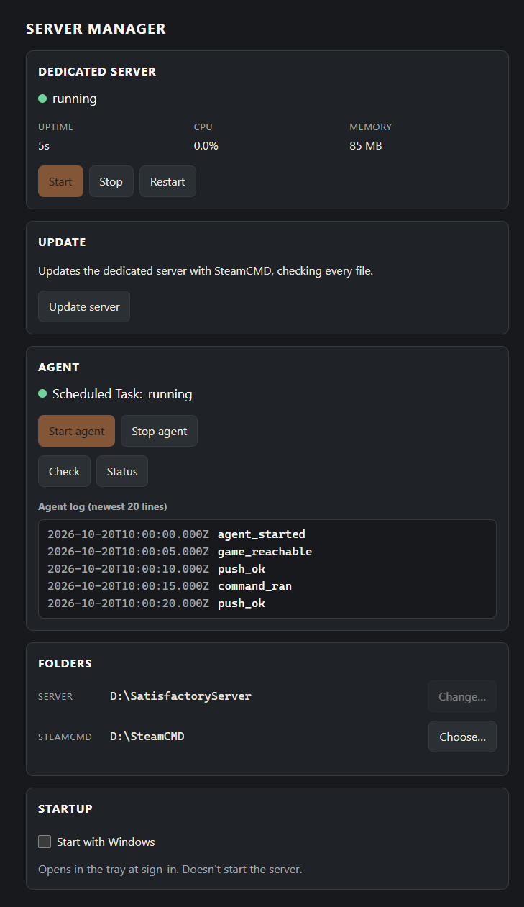
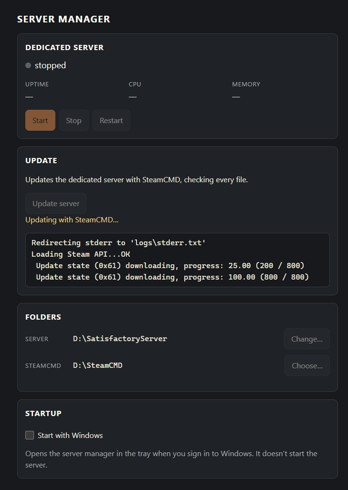
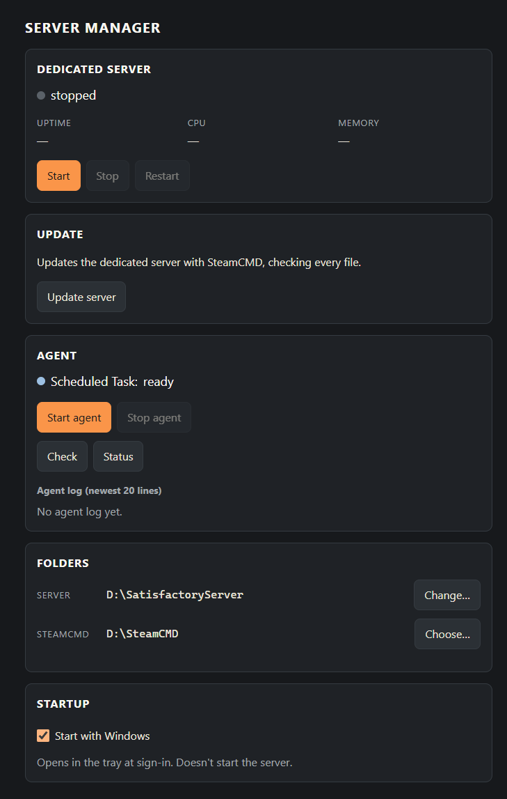
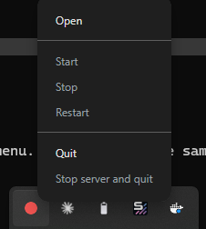
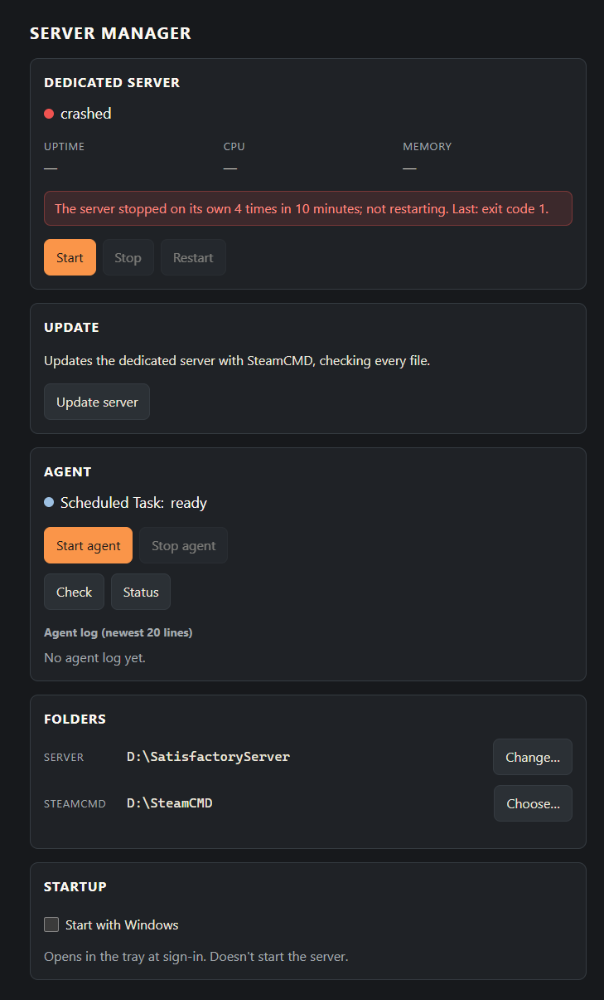

# Runbook: the server manager (ADR-0040)

A small Electron app, for the owner's game PC only, that starts and supervises the Satisfactory dedicated server: Start,
Stop (a clean save first), Restart, Update through SteamCMD, a crash back-off, and a tray icon. It is a holdover until
the mod (ADR-0039), so there is no installer, no signing and no auto-update. The edge agent beside it is a separate
program with its own runbook, [`agent-app.md`](./agent-app.md); the server manager borrows only the agent's stored API
token, for the clean stop.

Source: `server-manager/` (npm workspace `@satisfactory-dash/server-manager`). Rules for changing it:
`server-manager/CLAUDE.md`.



The **Agent** panel shows the agent's Scheduled Task ("Satisfactory Dash Agent") and its log's newest 20 lines, starts
and stops the task, and runs the agent's `check`, `status` and (when the agent has halted) `resume`. Setting the agent
up stays in a console: [`agent-app.md`](./agent-app.md).

## Building and launching from the checkout

On the game PC, in a checkout of this repository:

```
git pull
npm ci
npm run build -w server-manager
npm start -w server-manager
```

`npm start` runs the checkout's Electron on `server-manager/` and opens the window. The app lives in the tray from then
on (see "The tray" below). Run it as yourself: it needs no administrator rights and must not be run elevated.

Electron 45 has no install script: `npm ci` installs only its package, and the Electron binary
(`node_modules/electron/dist/`) downloads the first time Electron is started through Node, as `npm start` does. A
shortcut or login item that points at `node_modules\electron\dist\electron.exe` directly skips that step. So after every
`npm ci`, run `npm start -w server-manager` once before using one. Without the binary, `electron.exe` exits at once and
only logs `Invalid file descriptor to ICU data received`.

## First run: the two folders

1. **The server folder.** The window asks for the dedicated server's install folder, the one that holds
   `FactoryServer.exe`. A folder without it is refused.
2. **The SteamCMD folder** (optional, for Update). Under **Folders**, **Choose…** the folder that holds `steamcmd.exe`.
   Until it is set, Update stays off.

Both are saved in `%LOCALAPPDATA%\satisfactory-dash-server-manager\settings.json`. **Change…** picks another server
folder (only while the server is stopped). Beside it, `preferences.json` holds Start with Windows and whether the
hidden-to-tray note was shown, and `server.pid` the pid of the server the app runs.

**The clean stop needs the agent set up.** Stop saves the game through the server's own API with the agent's API token
([`agent-app.md`](./agent-app.md), "First setup"). Without that token every button still works, but Stop, Restart and
Update can't save first: they say so and offer **Stop anyway** (or **Restart anyway**, **Stop anyway and update**), which
ends the server without saving.

## What each button does

| Control | What it does |
|---|---|
| **Start** | Runs the configured `FactoryServer.exe -log`, no shell, no console window. Off while a server already runs. |
| **Stop** | The clean stop: asks the game for the session name, `SaveGame`, then `Shutdown`, through the game's own API. If the process is still there 60 s after Shutdown it is ended, and the window says it stopped without a clean shutdown. |
| **Restart** | Stop as above, then Start, only if the stop ended the process. |
| **Stop anyway** | Shown only after a clean stop couldn't save. Ends the process without saving. |
| **Update server** | Stops the server cleanly if it runs (it asks first), then runs SteamCMD with `+force_install_dir <server folder> +login anonymous +app_update 1690800 validate +quit`, shows its output, reports the exit code, and offers **Start the server**. |
| **Start with Windows** | Off by default. On, it adds a per-user login item (Electron's `app.setLoginItemSettings`, the current user's Run entry) that opens the app in the tray at sign-in; off removes it. It never starts the server by itself. |

During an update the server card reads **stopped**: the server was stopped for SteamCMD, and the Update card's note
("Updating with SteamCMD…") and log show the progress.





## The tray

The icon's colour is the server's state: **green** running, **amber** starting or stopping, **red** stopped or crashed.
Its tooltip names the state. Click it to open the window; right-click for the menu:

- **Open**: shows the window.
- **Start**, **Stop**, **Restart**: as the buttons. When a stop can't save, the window opens with **Stop anyway**.
- **Quit**: ends the app and **leaves the server running**. The server runs detached, so it outlives the app. The next
  launch finds it (by the pid in `server.pid`, and only if that process still runs the configured `FactoryServer.exe`)
  and supervises it again instead of starting a second one.
- **Stop server and quit**: the clean stop first, then quit. If the clean stop can't save, the app stays open and the
  window offers **Stop anyway**; quit again afterwards.



The tray menu is a native menu, which the screenshot script can't capture, so this one was taken by hand.

**Closing the window** hides it to the tray (the first time, a note says so). Only one copy of the app runs: launching
it again shows the open one's window.

## The crash back-off

An exit the app didn't ask for (a crash, a clean exit, a failed start) restarts the server at once, at most **3 times in
10 minutes**. One more and the state is **crashed**: no more restarts, the tray turns red, and the window shows how many
times and the last reason. **Start** begins again with a fresh count.



## Updating the server manager itself

In the checkout: `git pull`, `npm ci`, `npm run build -w server-manager`, then **Quit** from the tray (the game server
keeps running) and `npm start -w server-manager` again; the new app adopts the running server. A login item keeps
working across updates, since it points at the checkout.

**Before moving the checkout, turn Start with Windows off** (the login item names the checkout's Electron and folder,
and removing it needs the same ones). If it was left on, the app at its new place shows the setting as off; turn it on
there, and disable the old entry in Task Manager's Startup apps.

## What it never does

- **Show or log a token.** The agent's API token goes only into the request to the game's API, never to the window, a
  log or an error message.
- **Open a port.** The window is a local file and the app listens on nothing (`server-manager/e2e/no-listen.spec.ts`).
- **Run as administrator**, or ask for elevation. Start with Windows is a per-user login item, not a Scheduled Task.
- **Run anything but the configured `FactoryServer.exe` and `steamcmd.exe`**, each with fixed arguments and no shell
  (plus PowerShell, with a fixed script, to read the server's CPU, memory and command line).
- **Change the agent's Scheduled Task.** The Agent panel only reads, starts and stops it, and runs the agent's `check`,
  `status` and `resume`; `set-tokens` and `enroll` stay in a console ([`agent-app.md`](./agent-app.md)).

## Troubleshooting

| Symptom | Cause and fix |
|---|---|
| "The clean stop needs the agent set up" | No API token in the agent's store. Set the agent up ([`agent-app.md`](./agent-app.md)), or use **Stop anyway** (no save). |
| "The clean stop failed while saving" | The game refused or didn't answer `SaveGame`; the server still runs. Try again, or **Stop anyway**. |
| "Stopped without a clean shutdown: the server was still running 60 s after Shutdown" | The game saved but didn't exit, so the app ended it. Nothing was lost. |
| "A server this app started earlier is still running… couldn't confirm it's this server" | `server.pid` names a live process whose command line couldn't be read, so the app won't take it over and Start stays off. End it in Task Manager (or wait for it to stop), and Start comes back. |
| State **crashed** | The server stopped on its own 4 times in 10 minutes. Read the reason in the window and the server's own log (its location: [NEEDS VERIFICATION]), fix it, then **Start**. |
| The update failed with an exit code | SteamCMD's own code; its output is in the window. Run it again; check disk space and that the SteamCMD folder is right. |
| Launching does nothing | The app is already running: look in the tray (overflow arrow). A second launch shows its window. |
| The window shows "Choose the server folder" again | `settings.json` is missing or invalid; choose the folder again. |
| Start with Windows doesn't open it at sign-in | The login item points at the checkout's Electron and folder: after moving the checkout the app shows it off; turn it on again (see "Updating"). |
| "Windows didn't take the change" or "The setting couldn't be saved" under Start with Windows | Nothing changed: the login item and the setting are as they were. Try again; check the data folder is writable. |
